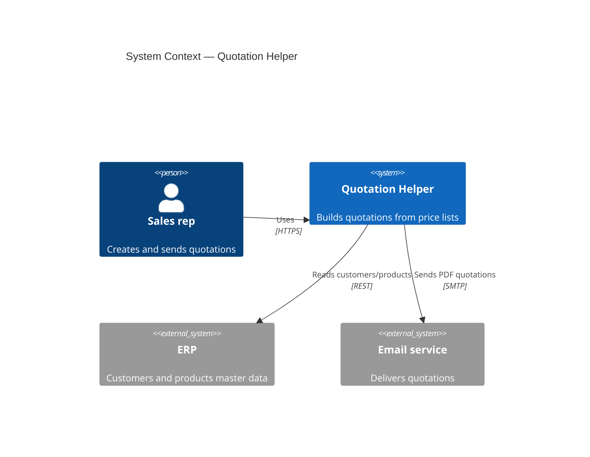
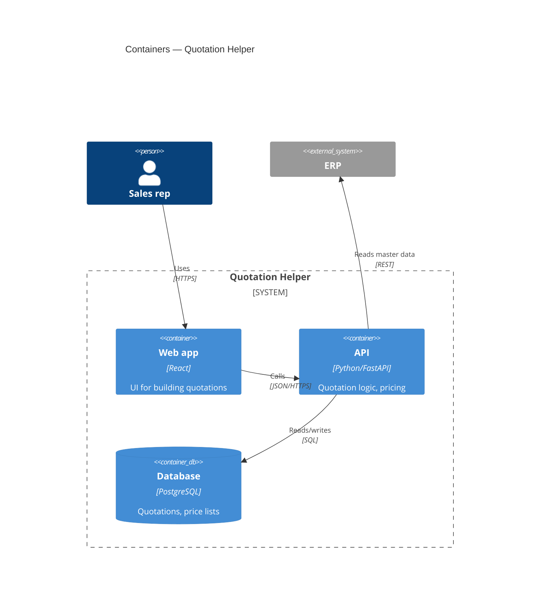
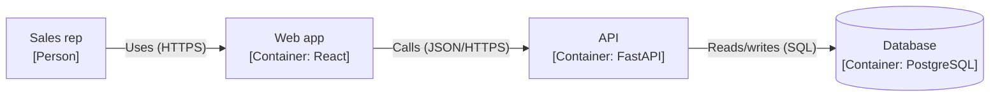

# C4 diagrams in arc42 (Mermaid)

The [C4 model](https://c4model.com) (Simon Brown) describes software
architecture at four zoom levels. In living-docs projects, C4 is the notation
for the diagrams inside `docs/ARCHITECTURE.md` (arc42 structure).

## Mapping C4 → arc42 sections

| C4 diagram | Shows | arc42 section |
|---|---|---|
| **System Context** (level 1) | The system as a box, its users and external systems | Context and Scope → Business / Technical Context |
| **Container** (level 2) | Deployable/runnable units: apps, APIs, databases, queues | Building Block View → Whitebox Overall System (level 1) |
| **Component** (level 3) | Components inside one container | Building Block View → Level 2 |
| Code (level 4) | Classes/functions — **usually omitted** (the code is the doc) | — |
| **Dynamic** | Runtime interactions for one scenario | Runtime View |
| **Deployment** | Containers mapped to infrastructure nodes | Deployment View |

Guidelines:
- Draw only what helps. Context + Container are almost always worth it;
  Component only for complex containers.
- Every element has a name, a type, a technology (for containers/components)
  and a one-line responsibility. Every relationship has a label (and protocol).
- Diagrams describe the system **as built**; update them in the same change as
  the code.

## Mermaid syntax

Mermaid supports C4 natively (`C4Context`, `C4Container`, `C4Component`,
`C4Dynamic`, `C4Deployment`). The syntax is marked *experimental* by Mermaid
and renders on GitHub/GitLab and most Markdown viewers. If a renderer has
problems, fall back to a `flowchart` using C4 labels (see last example).

### System Context

### Container

### Fallback with flowchart

(The examples are illustrative only, not decisions.)
